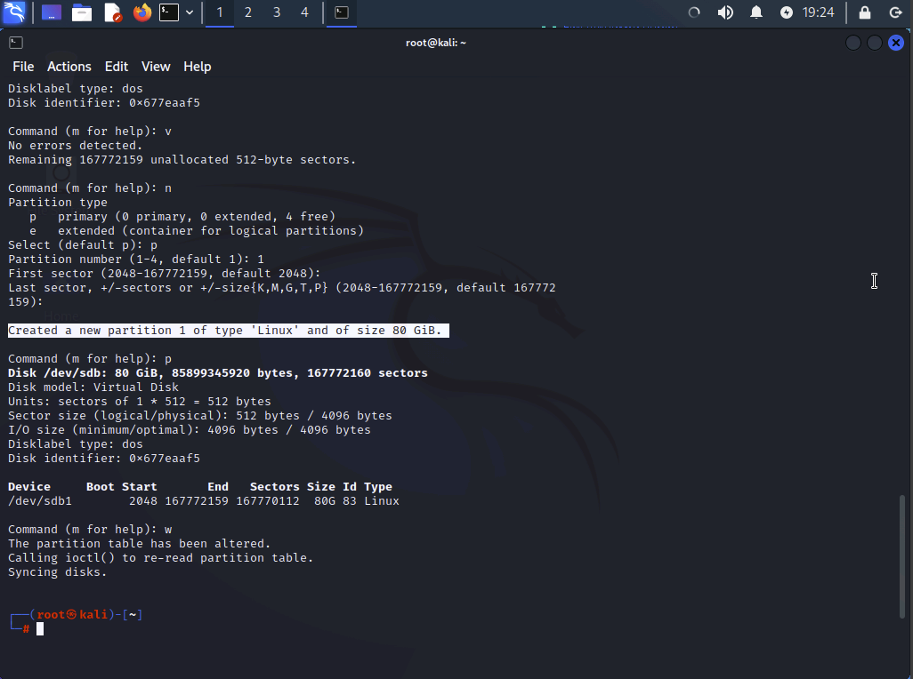
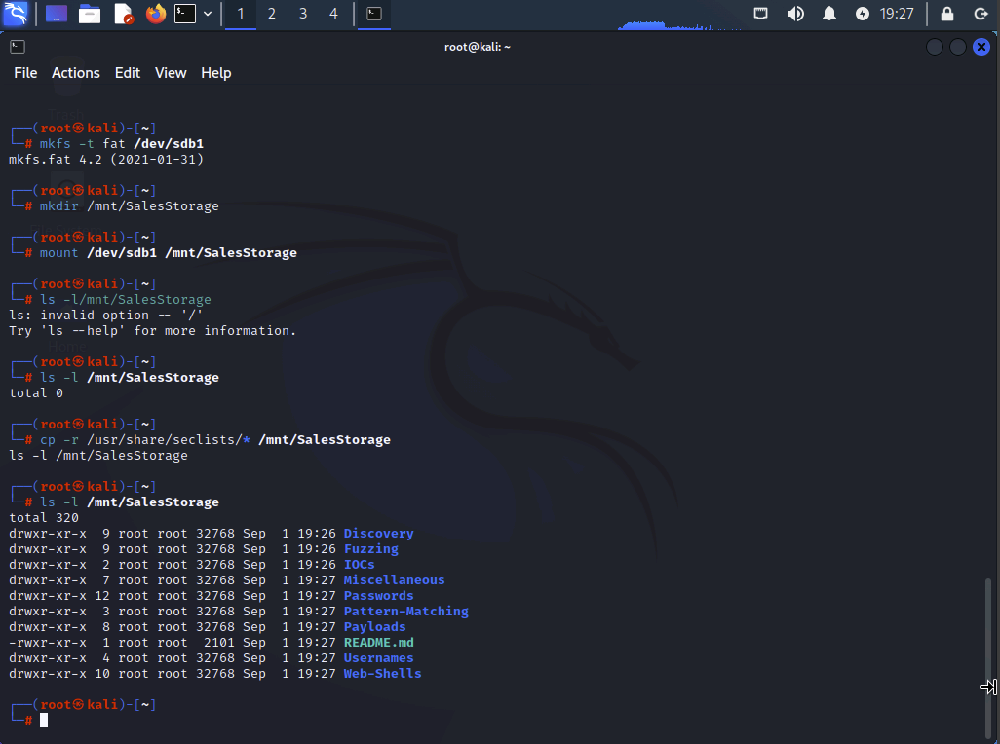
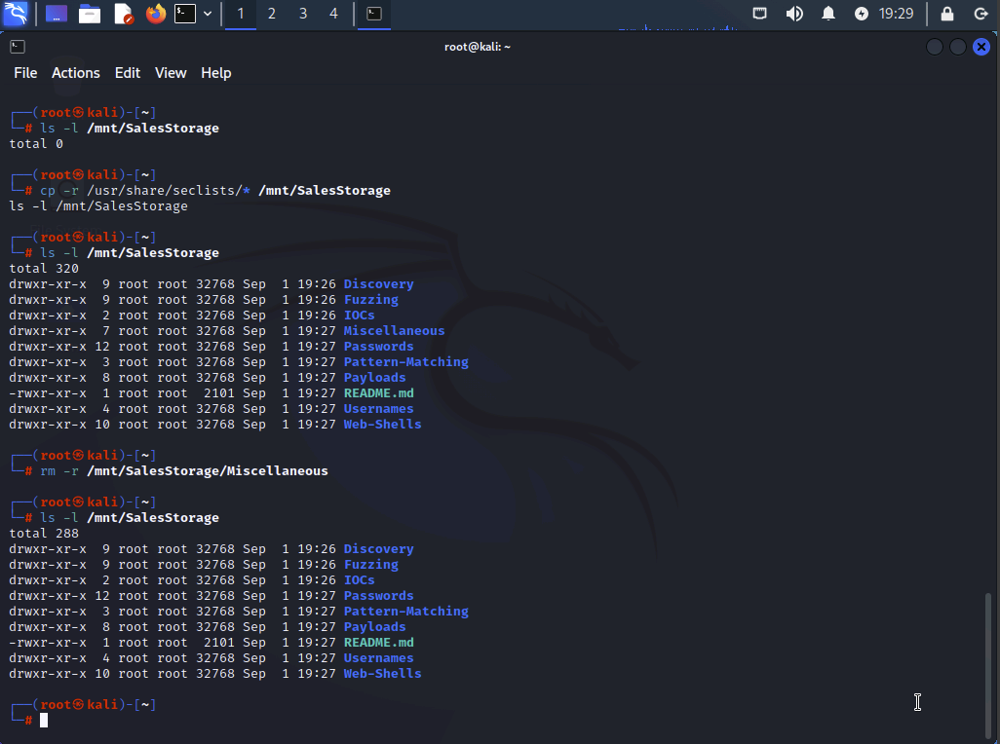
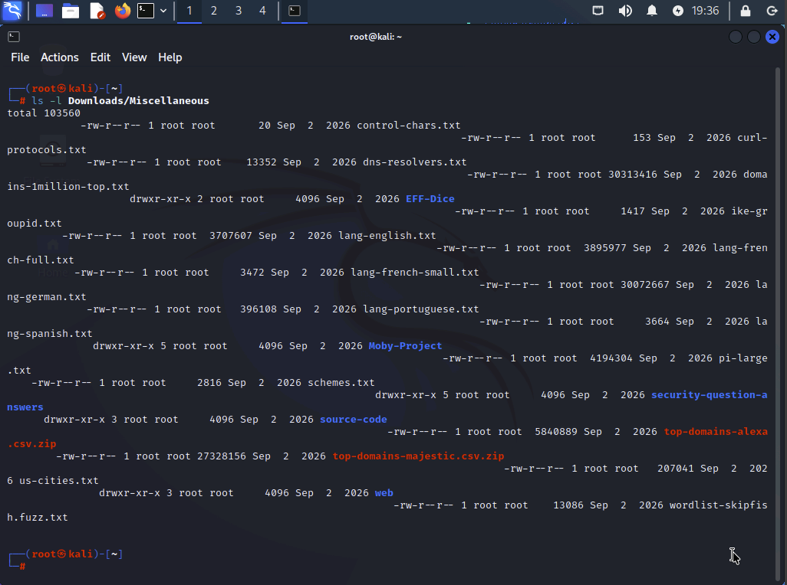
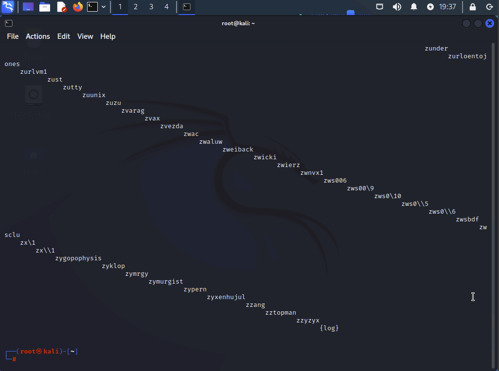
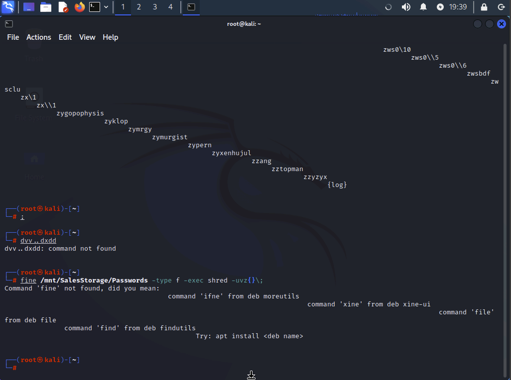
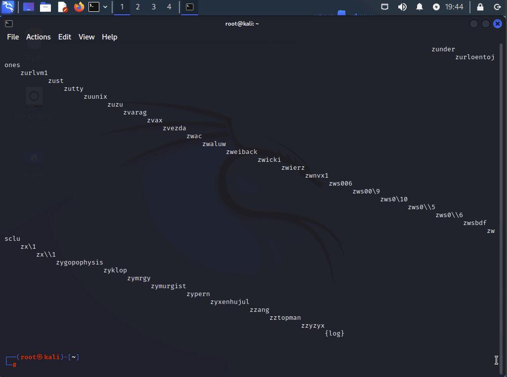
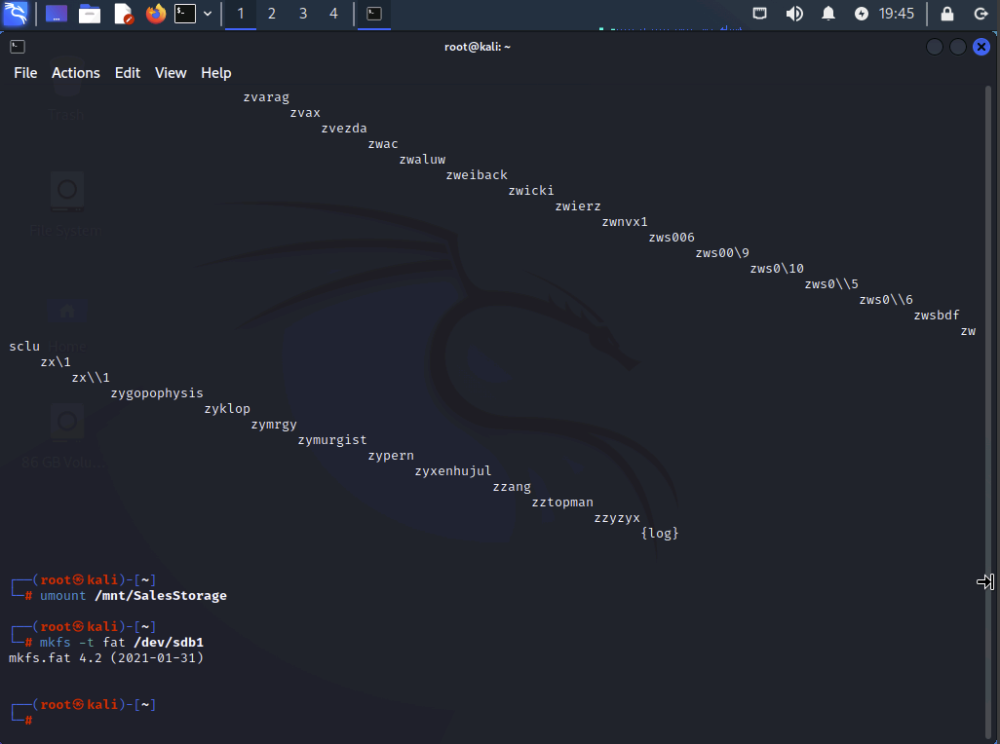
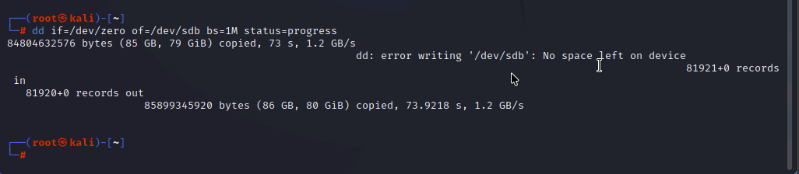

````markdown
# Applied Lab: Performing Drive Sanitization

## Overview

This lab demonstrates several methods of data deletion, data recovery, and drive sanitization using Kali Linux. The exercises cover creating and formatting a storage partition, recovering deleted files, securely deleting files with `shred`, and understanding why formatting alone is not considered secure sanitization.

This lab reinforces CompTIA Security+ concepts related to **data sanitization, data remnants, secure deletion, and storage media management**.

---

## Objectives

- Create and format a partition on a storage device.
- Mount and manage a storage device in Linux.
- Delete and recover files using TestDisk.
- Demonstrate why standard file deletion does not securely erase data.
- Securely delete files using `shred`.
- Understand why formatting alone is not secure sanitization.
- Identify common forms of data sanitization.
- Understand zeroization and overwriting.

---

## Environment

- **Operating System:** Kali Linux
- **Tool:** TestDisk
- **Storage Device:** 80 GiB storage device
- **Filesystem:** FAT

---

## 1. Creating and Formatting the Storage Device

The available storage devices were first identified using:

```bash
fdisk -l
````

The 80 GiB storage device was identified and partitioned using `fdisk`.

A new primary partition was created using the available space on the drive.



The partition table was reviewed to verify that the new partition had been created.



The partition was then formatted using the FAT filesystem:

```bash
mkfs -t fat /dev/sdb1
```

A mount point was created:

```bash
mkdir /mnt/SalesStorage
```

The new partition was mounted:

```bash
mount /dev/sdb1 /mnt/SalesStorage
```

The storage device was populated with files from SecLists:

```bash
cp -r /usr/share/seclists/* /mnt/SalesStorage/
```

---

## 2. Deleting and Recovering Files

The `Miscellaneous` directory was deleted using:

```bash
rm -r /mnt/SalesStorage/Miscellaneous
```

The directory was no longer visible through a normal directory listing.



TestDisk was then used to attempt recovery of the deleted data:

```bash
testdisk /dev/sdb1
```

Within TestDisk, the **Undelete** function was used to locate the deleted directory and copy it to the Downloads directory.



The recovered directory was then verified.



### Security Concept: File Deletion

Normal deletion does not immediately destroy the data stored on disk. Instead, the filesystem marks the associated clusters or blocks as available for reuse.

Until those areas are overwritten, the original information may still be recoverable.

This demonstrates why simply deleting a sensitive file is not sufficient for secure data sanitization.

---

## 3. Securely Deleting Files with `shred`

The `Passwords` directory was examined to identify the files that would be securely deleted:

```bash
ls -lR /mnt/SalesStorage/Passwords
```

The contents of a password file were viewed:

```bash
cat /mnt/SalesStorage/Passwords/bt4-password.txt
```



The files were then securely overwritten using the `shred` command:

```bash
find /mnt/SalesStorage/Passwords -type f -exec shred -uvz {} \;
```

The `shred` command overwrites the contents of files, making the original data much more difficult to recover.



The `Passwords` directory was subsequently removed:

```bash
rm -r /mnt/SalesStorage/Passwords
```

TestDisk was used again to attempt recovery.

The files could still be identified during the recovery process, but their original contents had been overwritten.



### Security Concept: Secure Deletion

This demonstrates the difference between:

* **Normal deletion:** Marks storage space as available for reuse.
* **Secure deletion:** Overwrites the data so the original contents cannot be easily recovered.

---

## 4. Formatting the Drive

The storage partition was unmounted:

```bash
umount /mnt/SalesStorage
```

The partition was then formatted again:

```bash
mkfs -t fat /dev/sdb1
```

TestDisk was used to check whether files could still be recovered.



### Security Concept: Formatting Is Not Sanitization

Formatting a storage device should not automatically be considered secure sanitization.

Depending on the type of formatting performed, the underlying data may remain on the storage media and potentially be recovered using specialized forensic tools.

---

# Sanitization Concepts

## What Is Data Sanitization?

**Data sanitization** is the process of intentionally removing or destroying data from storage media so that the information cannot be recovered using an appropriate level of effort.

Sanitization is especially important when disposing of, transferring, or repurposing storage devices that contain sensitive information.

---

## Common Forms of Sanitization

Two common forms of sanitization demonstrated by the lab are:

### Writing Random Data

Data can be sanitized by overwriting existing information with random data.

This replaces the original contents with unrelated values, making recovery of the original information significantly more difficult.

### Zeroization

**Zeroization** replaces existing data with zeros.

For example, an entire storage device can be zeroized using a command such as:

```bash
dd if=/dev/zero of=/dev/sdb bs=1M status=progress
```

Zeroization is a form of overwriting used to remove the original information from storage media.

---

## Important Security+ Concepts

### Data Remnants

**Data remnants** are residual representations of data that remain on storage media after deletion or other operations.

### Deletion

Deleting a file normally marks its storage blocks or clusters as available for reuse rather than immediately destroying the underlying information.

### Overwriting

**Overwriting** replaces existing data with other data. This can include writing random data or zeros to storage.

### Zeroization

**Zeroization** is a sanitization technique that overwrites data with zeros.

### Formatting

Formatting primarily creates or recreates filesystem structures. It should not automatically be treated as a secure method of sanitizing sensitive data.

---

## Security+ Knowledge Check

### Which of the following are common forms of sanitization?

**Correct answers:**

* **Writing random data**
* **Zeroization**

The following are **not** forms of sanitization:

* Storing fragments contiguously
* Marking clusters or blocks as bad
* Moving the file to other directories

---

## Key Takeaways

* **Deleting a file does not necessarily destroy its data.**
* Deleted data may remain recoverable until the underlying storage is overwritten.
* **TestDisk** can recover deleted files when their data has not been overwritten.
* **`shred`** can overwrite individual files to make recovery more difficult.
* Formatting alone should not be assumed to securely erase sensitive information.
* **Writing random data** is a common sanitization method.
* **Zeroization** is another common sanitization method.
* Sanitization is important when storage media is being disposed of, transferred, or reused.
* Proper media sanitization helps prevent unauthorized recovery of sensitive information.

---

## Commands Used

```bash
fdisk -l
fdisk /dev/sdb
mkfs -t fat /dev/sdb1
mkdir /mnt/SalesStorage
mount /dev/sdb1 /mnt/SalesStorage
cp -r /usr/share/seclists/* /mnt/SalesStorage/
rm -r /mnt/SalesStorage/Miscellaneous
testdisk /dev/sdb1
ls -lR /mnt/SalesStorage/Passwords
cat /mnt/SalesStorage/Passwords/bt4-password.txt
find /mnt/SalesStorage/Passwords -type f -exec shred -uvz {} \;
rm -r /mnt/SalesStorage/Passwords
umount /mnt/SalesStorage
dd if=/dev/zero of=/dev/sdb bs=1M status=progress
```

---

## Conclusion

This lab demonstrated the difference between ordinary file deletion, file recovery, secure deletion, formatting, and true data sanitization.

Using TestDisk showed that deleted information can remain recoverable, while `shred` demonstrated how overwriting can make individual files significantly harder to recover. The lab also reinforced that formatting alone is not sufficient for securely sanitizing sensitive storage media.

The key Security+ takeaway is that **common forms of sanitization include writing random data and zeroization**.

```
```
